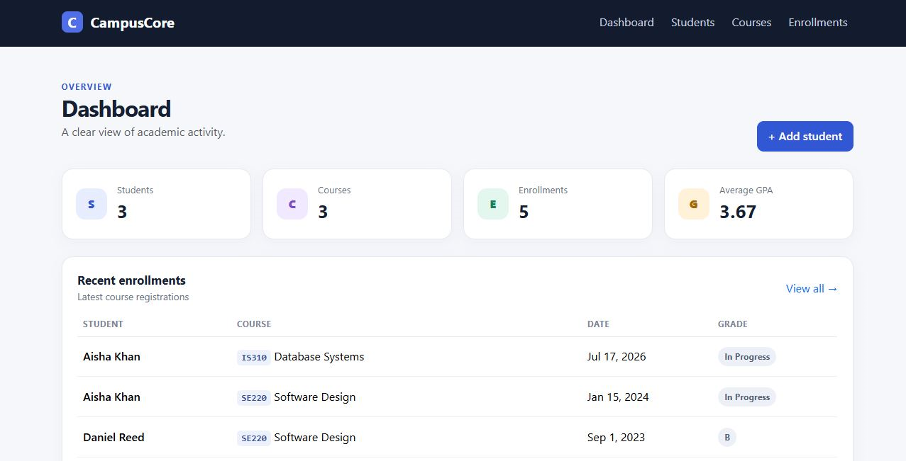
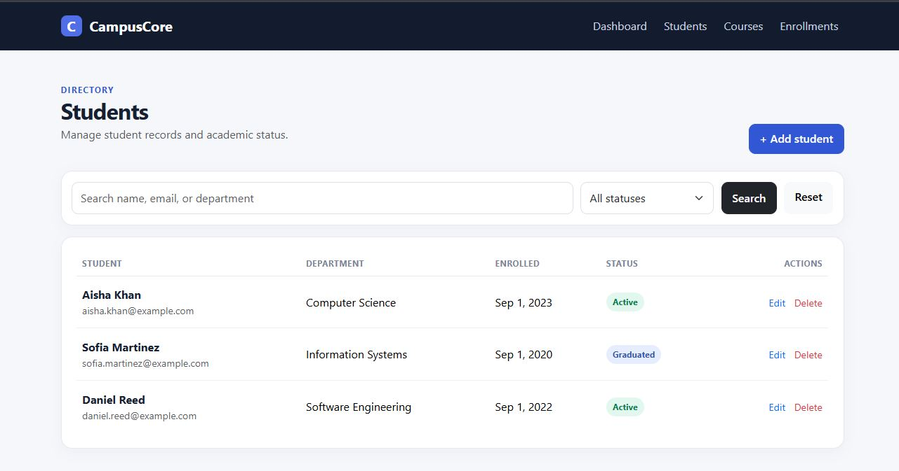
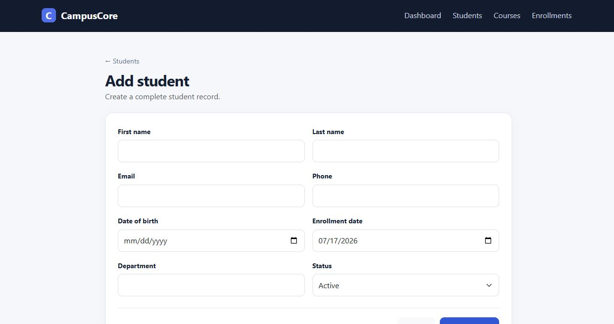
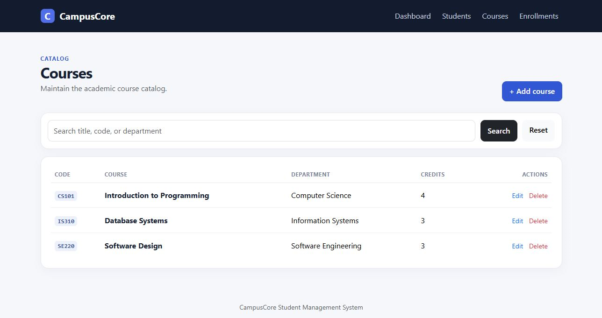
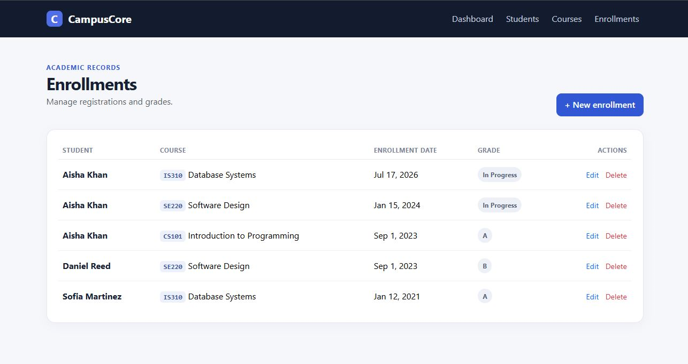

# CampusCore — Student Management System

A professional ASP.NET Core MVC application for managing students, courses, enrollments, and grades. CampusCore is intentionally scoped as a focused Version 1 portfolio project: it demonstrates practical C#, MVC, Entity Framework Core, relational data modeling, validation, and responsive UI work without placeholder features or unnecessary infrastructure.

**Live demo:** [https://jamal-student-management.runasp.net/](https://jamal-student-management.runasp.net/)

## Features

- Dashboard with student, course, enrollment, and GPA summary cards
- Recent enrollment activity
- Full student CRUD with profile and course history
- Full course CRUD with enrolled-student detail
- Enrollment creation, grade assignment, editing, and deletion
- Student search by name, email, or department and status filtering
- Course search by title, code, or department
- Server- and client-side validation with friendly messages
- Unique email, course code, and student/course enrollment constraints
- Responsive custom Bootstrap interface, empty states, and delete confirmation pages
- SQLite database, initial EF Core migration, and realistic demo seed data

## Tech stack

- .NET 8 / ASP.NET Core MVC
- C#
- Entity Framework Core 8
- SQLite for local development
- Microsoft SQL Server for the hosted production demo
- Razor views
- Bootstrap 5 with custom CSS

## Project structure

```text
student-management-system-dotnet/
├── Controllers/       MVC request handlers and filtering
├── Data/              AppDbContext and demo-data initializer
├── Migrations/        Initial EF Core database migration
├── Models/            Student, Course, and Enrollment domain models
├── ViewModels/        Dashboard-specific presentation model
├── Views/             Razor views grouped by feature
├── wwwroot/css/       Custom responsive application styling
├── Program.cs         Service registration and request pipeline
└── appsettings.json   SQLite connection configuration
```

## Setup

Prerequisites: [.NET 8 SDK](https://dotnet.microsoft.com/download/dotnet/8.0).

```bash
git clone <your-repository-url>
cd student-management-system-dotnet
dotnet restore
dotnet tool install --global dotnet-ef
dotnet ef database update
dotnet run
```

Open the HTTP or HTTPS address printed by `dotnet run`. On first startup, the app also applies pending migrations and adds demo records when the database is empty.

## Database migrations

Create a migration after changing the model:

```bash
dotnet ef migrations add DescribeYourChange
dotnet ef database update
```

The local `studentmanagement.db` file is ignored by Git. Delete it and run `dotnet ef database update` to reset local data; demo data is inserted when the application next starts.

## Screenshots

### Dashboard



### Students



### Student form



### Courses



### Enrollments



## Deployment notes

The live demo runs on MonsterASP.NET Free Hosting in its EU datacenter using .NET 8 and a free MSSQL database. Local development continues to use SQLite by default. The production application selects SQL Server through environment variables, applies the SQL Server EF Core migration during startup, and stores its hosted connection string only in the hosting dashboard.

The application was deployed from the release ZIP prepared from the `deploy/free-dotnet-hosting` branch. HTTPS is active through a free automatically renewed Let's Encrypt certificate, and HTTP requests are redirected to HTTPS.

MonsterASP.NET's free tier is suitable for a portfolio/demo workload rather than guaranteed production service. The current limits include 5 GB of website storage, 256 MB of dedicated application RAM, 1 GB of database storage, limited traffic, no automatic backup guarantee, no uptime guarantee, and possible archival after six months of inactivity.

## Future improvements

- Authentication and role-based authorization for administrators and staff
- Pagination for large student and course lists
- Audit history for grade and enrollment changes
- Exportable reports
- Automated unit and integration tests
- Production database configuration

## Limitations

- Version 1 intentionally has no authentication or authorization.
- SQLite is used for local development; the hosted demo uses MSSQL with synthetic seed data.
- Free hosting has limited traffic and resources, no automatic backup guarantee, and no uptime guarantee.
- GPA uses a simple A=4, B=3, C=2, D=1, F=0 average and excludes in-progress enrollments; it is not credit-weighted.
- Search uses straightforward database string matching.
- Course/student deletion cascades to related enrollments after an explicit confirmation page.
